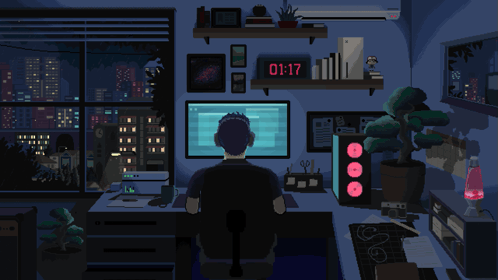

  

<h1 align="center">Leonardo Nogueira</h1>

  

  
  
  
  

  

 

<h3>&nbsp; Sobre mim</h3>

Sou o Leonardo, estudante de **Informática** em Fátima. Gosto de perceber como as coisas funcionam por dentro, e isso normalmente acaba comigo a desmontar, a reconstruir ou a programar alguma coisa.

Na minha mesa há quase sempre um **ESP32** ligado, uma peça acabada de sair da **impressora 3D** e um **site** aberto no editor. Os projetos de que mais gosto são aqueles onde o hardware e o software se encontram: uma luva que lê os movimentos da mão, um ecrã que mostra o que o PC está a fazer, um site que resolve um problema real.

Entre aulas, estágio e trabalho, aprendi a organizar o tempo e a acabar aquilo que começo.

&nbsp; Fátima, Portugal 
&nbsp; Curso Técnico de Informática, 12.º ano 
&nbsp; Estágio em desenvolvimento web 
&nbsp; Hardware, web, redes e realidade virtual

<b>Fora do código</b> (clica para abrir)

 

&nbsp; Imprimo peças em 3D para os meus projetos 
&nbsp; Fã de Fórmula 1 e de sim racing 
&nbsp; Jogo nas horas vagas

 

 

<h3>&nbsp; Em desenvolvimento</h3>

<table>
  <tr>
    <td width="50%" valign="top">
      &nbsp; <b>Luva VR</b> 
      Luva com sensores nos dedos e um ESP32 que transforma os movimentos da mão em comandos de realidade virtual. Projeto final de curso.
        
      <code>████████████░░░░░░░░ 60%</code>
    </td>
    <td width="50%" valign="top">
      &nbsp; <b>Website</b> 
      Site institucional desenvolvido no estágio, do design à publicação, a pensar em computador e telemóvel.
        
      <code>█████████░░░░░░░░░░░ 45%</code>
    </td>
  </tr>
</table>

 

<h3>&nbsp; Projetos</h3>

Clica em cada projeto para ver mais detalhes.

&nbsp; <b>Luva VR</b> · luva com sensores para controlar jogos em realidade virtual

 

Uma luva que lê a posição de cada dedo e envia os dados em tempo real para a realidade virtual. A ideia é deixar os comandos de lado e usar os movimentos naturais da mão para interagir. É o meu **projeto final de curso (PAP)**.

  

&nbsp; <b>PCDeck</b> · ecrã touch que mostra o que se passa no PC

 

Um pequeno painel com ecrã touch de 4" ligado ao PC. Mostra a música que está a tocar, o estado do computador e tem atalhos rápidos, tudo controlado por um ESP32.

 

 

<h3>&nbsp; Competências</h3>

<table>
  <tr>
    <td width="50%" valign="top">
      &nbsp; <b>Eletrónica e robótica</b> 
      Microcontroladores, sensores, montagem de circuitos e comunicação entre dispositivos
    </td>
    <td width="50%" valign="top">
      &nbsp; <b>Desenvolvimento web</b> 
      Sites e sistemas web, front-end e back-end com base de dados
    </td>
  </tr>
  <tr>
    <td width="50%" valign="top">
      &nbsp; <b>Redes</b> 
      Configuração de redes, endereçamento IP, routers e switches
    </td>
    <td width="50%" valign="top">
      &nbsp; <b>Realidade virtual</b> 
      Desenvolvimento de jogos VR em Unreal Engine para Meta Quest
    </td>
  </tr>
  <tr>
    <td width="50%" valign="top">
      &nbsp; <b>Servidores e sistemas</b> 
      Montagem e manutenção de PCs, Linux e alojamento de servidores
    </td>
    <td width="50%" valign="top">
      &nbsp; <b>Trabalho em equipa</b> 
      Experiência a trabalhar sob pressão, com foco em qualidade e prazos
    </td>
  </tr>
</table>

&nbsp; <b>Ver ferramentas que uso</b>

 

**Hardware** 

**Jogos e VR** 

**Web** 

**Redes e sistemas** 

 

<h3>&nbsp; Atividade</h3>

  
  

 

<h3>&nbsp; Vamos falar</h3>

Tens um projeto com ESP32, uma ideia maluca de VR ou uma vaga em tecnologia? Manda mensagem, respondo sempre.

  

<a href="#">voltar ao topo</a>

